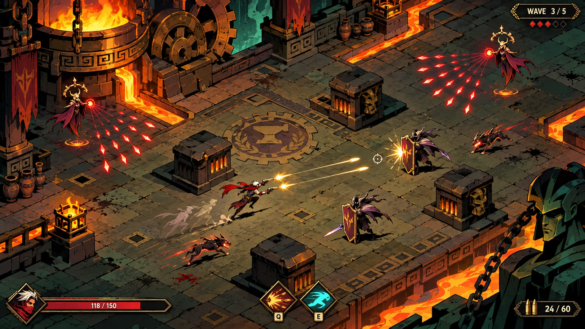

# CLAUDE.md — DREAD (working title)

Read this first. It explains what we are making, the look we are chasing, how the art is
produced, how the code is organised and how to test changes. Deeper docs:
[`docs/PLAN.md`](docs/PLAN.md) covers architecture decisions and status,
[`docs/ASSETS.md`](docs/ASSETS.md) covers the sprite/audio contract, and
[`README.md`](README.md) covers controls and dev flags.

## 0. Where we are and how a room gets made (read this first)

**Work on branch `claude/practical-clarke-pigy57`**; it reaches `main` through pull
requests (main and the branch were level on 2026-11-27, at PR #2). Before starting, fetch
and fast-forward it to `origin/main` in case main moved.

**The owner's goal:** a whole dungeon that looks like mockup 01 (Hades-style soul-fire
temple), built room by room. The rooms so far, all in `src/dungeon/layout_temple.gd`
(**the game's default level**; the original test level is `--level=test`):

| # | Room (`ROOMS` id) | Map columns | State |
|---|---|---|---|
| 1 | THE SOUL-FIRE TEMPLE (`temple`) | 0-23 | painted (`assets/rooms/temple_01`, the inked v3, plus `temple_east_01` for the right half, painted with its new enclosing walls) |
| 2 | THE HOODED SANCTUM (`sanctum`) | 26-37 | painted (`assets/rooms/sanctum_01`); its props were moved to match the painting |
| 3 | THE BONE ALTAR (`altar`) | 42-54 | painted (`assets/rooms/altar_01`); no pit: a ritual hall with a central altar, three bone nests that spawn hounds until broken, fire urns, then a shielded elite Legionnaire; drops a chest and opens the exit portal. Props follow the painting (its banners became plain frieze, braziers and candles became painted shrubs) |
| 4 | THE GREAT STAIR (`gallery`) + THE UNDERCROFT (`undercroft`) | 59-79, rows 0-19 | painted in two halves (`assets/rooms/stair_01` = the gallery, `undercroft_01` = everything below the terrace's top edge; each was masked to its half with `clip_paint.py` so they meet along that edge). SOL painted the gallery only to column 76; the painted right end was shifted out one cell to cover column 77 (see the paint guide README). L-shaped and on **two levels**: a long upper gallery (hounds and witches, then a Legionnaire and skulls), a grand stair cut into its front terrace, and a sunken hall 3.3 m below (Legionnaires in the hall while Hex Witches shoot down from the gallery, then a molten elite); drops a chest and opens the exit portal |
| 5 | THE HALL OF SHADES (`shades`) | 84-99, rows 4-16 | painted (`assets/rooms/shades_01`, one painting for the whole hall, guide `--look=90.55,9.05 --zoom=0.525`; the Undercroft corner of the frame was clipped out). A big square hall after the Undercroft (bridge from its right edge at row 14, entering through a doorway in the left wall), modelled on a Hades chamber the owner shared: four hooded shrine blocks around an open central field between gold bands, emblem plates, niche-and-mural walls; three waves ending with a frenzied elite; drops a chest and holds the exit portal |

**Repaint in progress:** rooms 2-5 have new paint guides with their enclosing walls
(`docs/paint_guides/*_02_*`, same cameras as `_01`; see "Round 2" in that README). Until
they come back, those rooms use their `_01` paintings with the new walls in kit art.

Rooms are joined by 3-wide stone corridors (map rows 2-4, and rows 13-15 into room 5;
they were gold bridges until 2026-11-27), and `ENCLOSE` walls in every open floor edge
(`Dungeon._enclose_floor`), so the world reads as one building, not islands; the last
room holds the exit portal (`X`, and `"exit": true` in its `ROOMS` entry), which
descends to the next depth (the same rooms, harder). When adding a room after it, move
the `X` and the exit flag. New rooms
go further right in the **same map**: only ever add columns to the right or rows at the
bottom, never insert any before existing ones, or every painting's camera stops
matching its room. Keep a gap of abyss (4+ cells) between rooms, bridged, so each
room's back walls stay tall. **The art comes from the owner's image generator, SOL**, painted over frames the
game renders ("paint guides"). Recipe for every new room:

1. **Lay out the room** in a layout file (copy `src/dungeon/layout_temple.gd`). Rules:
   - The map's **top row and left column are the back walls** (on screen +i is
     down-right, +j down-left). They render 6 m tall automatically. Never put walls
     along the bottom rows or right columns: they would stand in front of the room.
   - Legend: `W` mural wall, `M` soul-fire niche, `P` frieze wall, `O` column, `Q` broken
     column, `:` plain floor, `B` bridge (over a pit or across the abyss), a space inside
     the floor = a soul-fire pit (enclosed void), `k` urns, `n` candles, `p` candelabra,
     `*` soul brazier, `o` laurel-skull plate, `w` cracked slabs, `,` mossy slabs, `S`
     start, `X` exit portal, `_` the face of a drop to a lower floor (void), `/` stairs
     (see "Terraces and stairs" in section 6). Full legend in `src/dungeon/dungeon.gd`
     (`FLOOR_CHAR`, `WALL_CHAR`, `PROP_CHAR`).
   - Check on the guide that nothing tall stands right in front of a feature on screen:
     cells with the same `i - j` line up vertically, the nearer one in front.
   - Keep explosive fire urns (`b`, 3.2 m blast) at least 2 cells off the entry path.
     Props, walls and markers stand on plain stone; only `.` gets random floor variants.
   - The path runs left to right like the mockup; keep one room within about one
     screen so one painting covers it.
   - Hook the layout up in `World._layout()` (as `--level=temple` is) and add `ROOMS`
     beats for its fights.
2. **Render the paint guide** (no HUD, no player, camera saved next to it), then its line art:
   ```bash
   VK_ICD_FILENAMES=/opt/lavapipe/lvp_icd.json xvfb-run -a -s "-screen 0 1536x1024x24" godot --path . --resolution 1536x1024 --fixed-fps 30 --audio-driver Dummy -- --level=temple --look=5.2,8.3 --zoom=0.8 --paint-guide --shots=/tmp/guide --shot-every=5 --quit-after=2.2
   cp /tmp/guide/shot_000.png docs/paint_guides/ROOM_guide.png; cp /tmp/guide/shot_000.json docs/paint_guides/ROOM_guide.json
   python3 tools/rooms/guide_lines.py docs/paint_guides/ROOM_guide.png
   ```
   `--look=X,Y` is the tile point the camera centres on; zoom 0.8 is the framing SOL
   handled best (the sanctum used 0.72 to fit the whole room). Look at the guide before
   handing it over. Guides show every wall solid (no fading around the hidden player)
   and hide the dormant exit portal.
3. **The owner paints it in SOL**: attach `ROOM_lines.png` + the mockup (+ `ROOM_guide.png`
   if SOL takes a third image), with the prompt in `docs/paint_guides/README.md` (edit the
   "What things are" list for the room). Ask for the result **as a PNG file**, not pasted
   inline, and with **pure black** outside the floor.
4. **Check alignment**: `python3 tools/rooms/check_paint.py PAINTING docs/paint_guides/ROOM_lines.png /tmp/check.png`
   and look at it: pits, bridges, columns and props must sit on the red lines. (SOL
   once followed an older guide's framing: try each guide's lines and use the one that fits.)
   SOL sometimes swaps or drops small props (the sanctum came back with amphorae for
   candles, shrubs, and no braziers). Walls and pits must match, but props can follow the
   painting: change the layout's prop letters to what was painted, because each prop
   shows the painting through its own outline. Bone nests are the exception: they keep
   their own sprite (`RoomPaint.KEEP_OWN`) so they still pulse and vanish when broken.
   Black out any stray bits SOL paints on the abyss (the altar came back with ruin
   fragments in a corner) before importing, or they draw over the neighbouring room:
   `tools/rooms/clip_paint.py PAINTING GUIDE_JSON OUT "i,j i,j ..."` blacks out a polygon
   given in layout cells. Where two paintings overlap (room 4), give each its own part
   along an architectural edge the same way; walls and props then draw whichever
   painting shows something at their base (`RoomPaint._pick`).
5. **Import** with the matching guide's camera, then list it in the layout's `PAINTS`:
   ```bash
   cp PAINTING docs/paint_guides/ROOM_painted_sol.webp
   python3 tools/rooms/import_room_paint.py docs/paint_guides/ROOM_painted_sol.webp docs/paint_guides/ROOM_guide.json ROOM
   godot --headless --path . --import
   ```
6. **Test and look**: `check_scripts.tscn`, a bot run in the room
   (`-- --bot --level=... --start=<room id> --quit-after=50`), and a rendered screenshot
   (`--look=... --shots=...`, section 6). If the room layout changes later, the painting no
   longer matches: render a new guide and repaint.

**Current art style (v3, Nov 2026):** the owner had SOL restyle every room painting with
heavy black ink, flat cel shading and purple-tinted shadows on green-grey stone, much closer
to the mockup; all five rooms in the game use it. Keep new rooms in this style: attach one
of the v3 paintings (`docs/paint_guides/*_painted_sol*.webp`) as a style reference next to
the mockup.

How it works: `src/dungeon/room_paint.gd` (painting = floor layer; walls/props draw it
through `paint_cutout.gdshader` so they still hide actors behind them; tiles stay where
the painting has no floor). Gameplay (collision, pits, enemies) always comes from the
layout. Details and limits: `docs/paint_guides/README.md`.

## 1. What we're making

**Genre:** a **2D isometric action-RPG twin-stick shooter**: fast, aggressive, loot-driven
dungeon crawling. It is fully 2D in **Godot 4.7.x (GDScript)**. Characters only *look* 3D
because they are pre-rendered from Blender.

**Feel targets (the original brief):**
- **DreadHunter:** isometric gunplay, aggressive encounters, weapon feedback.
- **DOOM Eternal:** relentless aggression, resource loops, visceral destruction.
- **Diablo IV:** loot rarity, builds, synergies, dungeon crawl.
- **Warframe:** fluid movement and abilities.
- **The Ascent:** dense isometric presentation.

**Pillars:** Speed · Impact · Fluidity · Progression · Chaos *with readability*.

**It is NOT:** a cover shooter, a slow tactical shooter, wave survival, or an extraction
game. "Waves" exist only as encounter beats inside rooms. The player should feel like an
apex predator: dash through formations, flank armoured enemies, pop explosives in crowds,
execute staggered enemies for health. **The game must be fun before it becomes big.**
Judge every feature by: does it make combat more satisfying, responsive, readable, or create
interesting decisions / build diversity?

**Original directive guardrails (keep honouring them):**
- Movement is never locked by animations; shooting, dashing and abilities overlap freely.
- Every enemy attack is telegraphed (pose + ground marker + sound) and is interruptible
  by stagger.
- Encounters mix enemy roles; never just "more of the same enemy".
- Loot modifiers change *behaviour* (pierce, ricochet, split, chain, explode, sustain),
  not just numbers.
- Camera shake is budgeted, hit-stop is short and rare, and VFX must never hide the fight.
- The architecture is modular and data-driven (Resources, a signal bus) and avoids giant
  scripts.

## 2. Art direction: Hades-style visuals, DreadHunter gameplay

The owner wants the game to look like **Hades**, with gameplay closer to **DreadHunter**:
a **hand-inked, cel-shaded mythic Greek underworld**.

**Concept art by the owner (the target look):**

| Mockup | What to take from it |
|---|---|
|  `docs/concept/mockup_01_soul_fire_temple.webp` | Dark green-stone temple, gold Greek-key (meander) trim, laurel/skull floor emblems, broken columns, urns, candles, **bright green soul-fire pits**. Gunslinger (hat, red scarf, dual pistols) with dash afterimages and golden tracers. Enemies: shield/sword skeleton warriors with green flame, flaming skulls, magenta enemy projectiles. HUD: portrait in a gold diamond plus a long red health bar (bottom-left), Q/E diamond ability icons (bottom-centre), "WAVE 2/4" plate with diamond pips (top-right), ammo "18/36" with bullet icons (bottom-right). |
|  `docs/concept/mockup_02_forge_lava.webp` | **Second biome (not built yet):** forge/lava: molten channels, gears, chains, red banners, furnace altars, giant statue head. Enemies: floating sorceresses firing red diamond shard spreads, hellhounds, cloaked shield warriors. Same HUD language. |

**Gameplay/feel references (DreadHunter screenshots):** `docs/concept/ref_dreadhunter_01..05_*.webp`.
These show camera angle, scale, density, HUD placement and lightning/critical-hit VFX.
They are reference only and not shipped art.

**Style rules:**
- Thick dark ink silhouettes and inner lines.
- 3-band toon shading with purple-tinted shadows.
- Saturated but dark palette: green-black stone, gold accents, crimson cloth.
- Bright emissive accents: green soul-fire, warm torches, magenta enemy magic.
- Strong colour separation: player is warm red/gold, enemies get a red rim and elites a
  gold rim, danger telegraphs are always red, spawns are green.
- UI font is **Cinzel** (`assets/fonts/`, OFL licence included), with gold frames and
  diamonds.

**The owner plans to make their own final art eventually.** Treat everything in
`assets/sprites` as high-quality placeholder. Keep all art behind the sheet contract
(`docs/ASSETS.md`). Never hard-code sprite sizes or offsets in gameplay code.

## 3. Current state (what exists)

All of this is playable, and a bot plays the whole route without errors:

- **Player (gunslinger):**
  - Responsive movement and a 2-charge dash with i-frames.
  - Twin-stick aim: mouse soft-lock, or stick with aim assist.
  - Three weapon slots: Twin Hellfire Revolvers (alternating barrels), Hellmouth
    Blunderbuss, Stormcaller (heat-based chain lightning).
  - Longshot (charge rail) as loot.
  - F Firebomb (was RMB until 2026-11-27).
  - Movement (owner: "should feel as satisfying as DreadHunter / Hades"): 7.6 m/s with
    snappy accel/stops; dash 6.1 m (bursts out, eases into the landing, exits at 1.3x run
    speed), with dust, a shock ring, a speed streak, dense afterimages and a camera push.
- **Abilities:** Q Shock Nova, E Seeker Swarm, RMB **Hellfire Saber** (`blade.gd`; the
  owner found the old whip pointless, so it was removed 2026-11-27). Melee is part of
  moving, so it sits on RMB for fast presses:
  - Tap or hold for slash, back-slash, heavy cleave. Each swing lunges forward and snaps
    onto an enemy in front within 4 m; the next swing can cancel the end of the last.
  - RMB during or right after a dash: a piercing dash-slash.
  - Any swing on a staggered (or nearly dead) regular enemy executes it for health and
    ammo; heavies only below 30% health. Elites and bosses are never executed (the owner
    saw the sword melt them): a staggered one takes a PUNISH hit (1.6x, guaranteed crit),
    and the sword builds stagger on them at half rate. Every sword kill spills ammo and
    health (the DOOM loop: diving in is how you refill).
  - The slash cuts enemy shots out of the air. Drawn by `vfx/slash_fx.gd` (a hellfire
    crescent swept on the ground plane).
- **Enemies** (internal ids stay `mite/spitter/brute/bloater`; names and art are themed):
  - **Hellhound** (`mite`): flanking swarmer, pounce.
  - **Hex Witch** (`spitter`): flying caster, shard fans.
  - **Shade Legionnaire** (`brute`): tower shield = 70% frontal armour (breakable), weak
    back, slam + charge, stuns itself on walls.
  - **Flaming Skull** (`bloater`): flying kamikaze that hurts enemies too.
  - **Elite affix layer:** frenzied, shielded, volatile, molten.
- **Loot:** six rarities, stat affixes, behaviour affixes and legendary/mythic perks.
  Also inventory (Tab), XP/levels and four attributes.
- **Dungeon:** the temple dungeon (default, section 0) and the original handcrafted test
  level (`--level=test`, `src/dungeon/layout_test.gd`, ASCII):
  - Threshold → Bone Corridor → secret Reliquary behind a breakable wall.
  - Locked Kennels arena (nests spawn hounds until destroyed).
  - Stormwalk (shock-plate hazard).
  - Hall of the Legion (elite finale) → descent portal to depth N+1, with harder enemies.
- **Temple look-test room** (`--level=temple`, `layout_temple.gd`), built toward mockup 01
  and now covered by the owner's SOL painting (`assets/rooms/temple_01`, see "Paint guides
  and room paintings"); `--no-paint` shows the kit underneath:
  soul-fire pits with capstone lips (the owner's pit pack), gold Greek-key bridges with
  sunburst medallions, mural walls with the hooded figure and laurels, green fire niches,
  dark green columns, grey slab floor. **The owner's goal (2026-11-27): make this room
  match the mockup, then build a whole dungeon from that concept**, so every piece is
  modular (pits from any void shape, bridges from `B` cells, walls by legend).
- **Presentation:**
  - Pooled VFX: particles, lights, decals, telegraphs.
  - Hit-stop, trauma shake, HDR glow, post FX.
  - Normal-mapped dynamic 2D lights.
  - Green soul-fire abyss shader.
  - Procedural SFX and layered music.
  - Gold-diamond HUD and minimap.
- **Performance:**
  - Low/Medium/High presets (F4, auto-picked by GPU, auto step-down below 45 FPS).
  - VRAM-compressed sprites (~122 MB).
  - Tiered static lights and a 1080p render cap on large screens.
  - F3 overlay.

**Not built yet / next ideas:**
- Still missing from mockup 01: the broken rock edge and dark broken posts in the
  foreground, a large laurel-skull floor plate, candles on ledges, skeleton sword-and-shield
  warriors with green-flame heads, and moodier lighting (darker edges, pools of light).
- A full dungeon built from the temple pieces (the owner's next step after the room).
- Forge/lava biome (mockup 02).
- Basic skeleton swordsman enemy.
- A boss with phases.
- Skill tree (reuse `Build.stat()` and perk hooks).
- Procedural room stitching.
- Options menu and save/load.
- Painted-art pass over the renders.
- Tuning by human playtest.

## 4. Code map

```
src/world.gd        Scene root: layers, environment, level build/rebuild, enemy factory, graphics presets, dev flags
src/autoload/       InputSetup (all bindings) · Events (signal bus) · Game (refs, hit-stop, settings) · Audio · VFX
src/core/           iso.gd (projection math) · sheet_db.gd (sprite sheets) · damage_info.gd
src/player/         player.gd (controller, movement, dash, weapons, inventory) · player_visual.gd (legs+torso compositor)
src/combat/         weapon_data/weapon/weapon_db · projectile(_system) · combat.gd (hit/explode) · build.gd (stats + perk hooks) · perks/
src/enemies/        enemy_data · enemy.gd (base FSM, armour, stagger, status, death) · mite/spitter/brute/bloater · elite.gd
src/abilities/      shock_nova · seeker_swarm · blade (RMB saber: combo / dash-slash / execute)
src/loot/           item · loot (generation/drops) · pickup
src/dungeon/        layout_test (ASCII + rooms/beats) · layout_temple (mockup look-test room) · dungeon.gd (grid collision, DDA raycast, flow field, floor/walls/lights) · pit_fire (soul-fire in enclosed chasms) · terrace (drops and stairs between floor levels) · encounter_director · prop · doors/portal/shock floor
src/ui/             hud.gd (procedural HUD + minimap) · inventory_ui.gd
src/vfx/            shaders/ (entity, glow_rim, post, post_lite, void_bg) · camera · post_fx · telegraph · tex_gen · glow_mat
src/debug/          bot_driver.gd (automated playtester)
data/weapons, data/enemies   .tres definitions — tune numbers here, not in code
```

**Key concepts:**
- **Three coordinate spaces** (`src/core/iso.gd`):
  - *screen* = node positions.
  - *ground* = `(x, y / 0.5)`, true metric with 1 m = 90.51 px. All speeds, radii and
    AoE use this.
  - *tile* = grid coords, where walls are axis-aligned squares.
- **Projection:** classic 2:1 isometric, like the owner's mockup: a 2 m cell is a 256×128
  diamond and a metre of height is 78.38 screen px (camera pitch 30°; it was 48.6° /
  256×192 until Nov 2026, changed so rooms read like the mockup).
  `Iso.lift(g, h_m)` draws a point that is h metres above the ground.
- **Collision:** custom grid collision and DDA raycasts (not physics bodies) for actors
  and projectiles. Enemy AI uses a flow field toward the player plus soft separation;
  stepping into a cell with a standing prop costs more (`Dungeon.PROP_FLOW_COST`), so
  enemies walk around props instead of getting stuck pushing into them. Still keep props
  from boxing in corners: the bot log prints where the last enemies are (`left:`) when a
  room stalls.
- **Combat routing:** all player damage goes through `Combat.hit_enemy()`, so the
  `Build`/`Perk` hooks (`before_hit`, `after_hit`, `on_kill`, `on_fire`, `on_dash`,
  `on_explosion`) fire for every source. To add a modifier, write a Perk class in
  `perk_lib.gd` and give it an `INFO` entry.
- **Content is data-driven:**
  - New gun = a `.tres` file plus an optional torso sheet.
  - New enemy = a `.tres` file plus a behaviour subclass of `Enemy`, registered in
    `World.spawn_enemy()`.
  - Room encounters = `ROOMS` beats in the layout file.
- **Systems talk through `Events` signals.** The HUD, audio, encounters and bot listen
  there.

## 5. Art production method (Blender → 2D sprites)

All placeholder art is built procedurally in **Blender via the `bpy` Python module**:
models are made from primitives in code, then rendered through a custom stylizer.

- **Setup:** `python3 -m venv ~/venvs/bpy && ~/venvs/bpy/bin/pip install bpy==5.3.0 pillow numpy`
  (needs Python 3.13). Always `import common` before `from mathutils import ...`,
  because bpy provides mathutils.
- **Rig** (`tools/blender/common.py`): orthographic camera, yaw 45°, pitch asin(0.5) =
  30°, 90.51 px/m, so it matches `Iso` exactly (`common.ISO_K` = `Iso.K`). Key light from screen upper-left, cool
  rim from behind.
- **Stylizer** (`render_stylized()`): every frame is rendered at 2× supersampling as
  separate Cycles passes:
  - flat **albedo** (emission branch inside every material)
  - **lighting** (white diffuse override, including self-shadowing)
  - **meta** (metalness, emissive flag, view depth)
  - **normal** (top-down frame for Godot `Light2D`)
  - **emission**

  numpy then composites them:
  - 3 light bands with purple shadow tint
  - gold/metal glints
  - paper grain
  - ink lines from depth/normal/albedo discontinuities plus a dilated outer silhouette

  The result is downsampled to final size. Tune it with `common.STYLE`.
  `build_env.py` uses calmer `ENV_STYLE`/`FLOOR_STYLE` so floors stay readable under
  combat.
- **Painted textures** (`tools/blender/textures/`): environment surfaces can use painted
  images instead of flat colours. They are made with the environment prompt book
  (https://claude.ai/artifact/9JXvw5rE37iezcSMhqP5Yv) and must be flat and straight-on,
  never isometric.
  - `C.mat(..., tex=C.tex_path("file.png"), tex_size=(x, y, z))` maps one onto a model
    (metres per repeat along object X/Y/Z, centred on the object's origin). The image
    feeds the albedo pass too, so shading, ink lines and normal maps still come from the
    stylizer. Options: `tex_proj` (`"FLAT"` for floors, because Cycles' box projection
    swaps axes on upward faces; `"BOX"` for walls), `tex_rot`, `tex_extension`
    (`"EXTEND"` for single non-tiling images), `tex_gain`, and `tex_emit` for painted
    light such as flames.
  - `build_env.py → PAINTED` says which file each floor/wall kind uses. A missing file
    falls back to the modelled look, so the kit still runs without textures.
  - Current set: floors are large 50–90 cm slabs, lifted ×1.3 in the material (`flag2`
    uses the same slabs turned 90°). `tools/blender/prep_textures.py` makes them from the
    kit originals in `textures/kit_2026-11-27/textures_large_slabs/`: it evens out
    slab-to-slab colour (otherwise the 2 m repeat reads as a checkerboard) and blends the
    edges so the image repeats (`slab_worn`, `slab_damaged`, `slab_moss_bones`). Its
    `cool()` then makes the copies the game actually uses (`slab_*_cool`): half the
    saturation and slightly cooler, because the mockup's floor is grey stone, not olive,
    and with the slab joints widened and darkened, because the kit's hairline joints
    vanish at game size. `slab_worn_cool_plain` (no joints) is for the pit capstones.
    Also `floor_border_meander` (floors, the low `cut` wall and bridge bands),
    `floor_emblem_skull`, `floor_emblem_sun` (sunburst plate and bridge medallions),
    `wall_ashlar` (gold band moved lower), `soulfire_flames` (fire-alcove niches) and
    `wall_hooded_panel`: the kit's painted hooded-figure wall module unprojected flat by
    `prep_textures.py` (`HOODED` holds the measured corner lines), used as the mural on
    relief walls (legend `W`). Older textures (`floor_flag`, `floor_cracked`, `floor_moss`,
    `column_wrap_v1`) are kept but unused.
  - Unprojecting painted modules: generated modules are drawn at roughly the game angle
    but not exactly, so they can't be used as tiles directly. Measure the face's corner
    lines on the image, resample it to a flat rectangle (`unproject_relief()`,
    `prep_pit_textures.py`), and use the result as a texture or a runtime-drawn surface.
  - `textures/kit_2026-11-27/` holds the owner's full generated kit (textures, props,
    wall modules, decals, glow masks) with its own README and prompts.
    `textures/kit_2026-11-27_pits/` holds the owner's floor-and-pit pack (pit edges and
    corners, a whole pit, README, prompts); its bridge and floor images didn't come
    through as files and aren't stored.
- **Props are painted, not modelled:** `tools/blender/import_painted_props.py` turns the
  kit's painted prop sprites into the 8 prop sheets (amphorae → `crate`, candles →
  `canisters`, fire urn → `barrel`, chest, soul brazier → `crystals`, candelabra →
  `pylon`, broken statue → `cryotube`, bone nest → `eggs`). It scales each from its
  real-world size, anchors it on its base and builds the glow layer from the kit's glow
  masks. They ship without normal maps. `build_env.py -- props` brings back the
  modelled ones.
- **Sheet edges:** `SheetWriter.save()` runs `bleed_alpha()` on colour sheets. Without it
  the stylizer leaves faint white semi-transparent pixels at silhouettes, and texture
  filtering turns them into light fringes and dotted seams between floor tiles.
- **Output** goes to `assets/sprites/<category>/<name>_c.png` (colour), `_n.png`
  (normal), `_e.png` (emission) and `.json` (frame size, origin = feet/tile centre,
  rows = directions). See `docs/ASSETS.md`.
- **Directions:** row 0 faces screen-right and rows go clockwise; row 4 of 16 faces the
  camera. Characters use 16 dirs. The player torso uses 32 aim dirs in a 4×8 grid; the
  legs sheet uses 16 dirs with 8 run frames + 1 idle.
- **Scripts and render times (4 cores):**
  - `build_player.py`: gunslinger legs, 4 torsos, HUD portrait (`-- portrait`); ~10 min.
  - `build_enemies.py`: hound/witch/legion/skull, one sheet per animation; ~20 min per
    pair. Run two processes in parallel.
  - `build_env.py`: 19 floor kinds (11 floors, then 8 bridge decks), 10 wall kinds (incl.
    freestanding `pillar` and `pillar_broken`, legend `O`/`Q`, and `cut`, a waist-high
    wall) in a 3 m and a 6 m sheet (`-- walls` renders both, `-- tall` only the 6 m one),
    3 low blocks, 8 props, and the 16 pit capstone pieces (`-- pits`); ~3 min.
    Index order is fixed because the layout legend maps to it.
  - `prep_pit_textures.py` (plain python): unprojects the pit pack's painted wall into
    `assets/sprites/env/pit_wall.png` (one clean masonry course, tiling) and
    `pit_flames.png` (the painted flames on transparency, tiling along x).
- **Before full renders:** preview a few frames first (render a contact sheet with
  `render_stylized()` and look at it). That's how every model so far was iterated.
- **After re-rendering:** run `godot --headless --path . --import`. Sprites import
  VRAM-compressed (`compress/mode=2`, set as the project importer default).

## 6. Testing & tooling

```bash
godot --headless --path . --import                                    # refresh imports + class_name cache (needed after adding class_name scripts)
godot --headless --path . res://tools/dev/check_scripts.tscn          # compile-check every script/resource
godot --headless --path . --fixed-fps 60 -- --bot --quit-after=240    # automated playthrough of the temple dungeon, prints a combat log
godot --headless --path . --fixed-fps 60 -- --bot --level=test --quit-after=120   # the same on the original test level
godot --headless --path . --fixed-fps 60 -- --bot --bot-human --bot-nododge --quit-after=120   # harder difficulty probe
godot --path . -- --start=gallery --depth=2 --gfx=low                 # jump to a room / depth / preset while playing
```

- **Rooms for `--start`:** temple dungeon (default) `temple sanctum altar gallery
  undercroft shades`; with `--level=test`: `landing conduit vault hatchery spine reactor`.
  `--level=temple` is still accepted (it is the default).
- **Look test:** `--level=temple` builds a single room composed like the temple mockup
  (`layout_temple.gd`), laid out the mockup's way so the path runs left to right with
  nothing in front of it: the map's left column and top row are the back walls (6 m
  tall: the mural wall up the left to a corner column, then the frieze wall with columns
  around the back of the arena), a band of soul-fire pits with two gold bridges runs down-right
  from the mural wall's base, the open arena spreads right, and the near edges break off
  into the abyss. (On screen +i is down-right and +j down-left, so walls on the map's
  bottom rows or right columns would stand in front of the room.) Add `--start=temple` with
  `--bot`. `--zoom=N` multiplies the camera zoom; at the 30° camera the default zoom
  already matches the mockup's scale. `--look=X,Y` makes a still: the player stands on
  that tile point, no encounters start and the camera has no mouse look-ahead. Use it
  with `--shots` (the first shot is at 2 s) to compare a room against concept art:
  `-- --level=temple --look=5.5,8.5 --shots=/tmp/s --shot-every=5 --quit-after=2.2`.
- **Near walls fade:** a wall with the room behind it and nothing walkable in front
  (`dungeon._cut_near_walls()` marks it in `near_walls`) is a full wall that fades out in
  a wide window around the player (`_fade_occluders`), DreadHunter-style, so rooms are
  enclosed on the camera side too without hiding the fight. Paint guides show them solid.
- **Enclosure:** with `ENCLOSE` in the layout, every empty cell touching walkable floor
  becomes a wall (`_enclose_floor`; pits and drops excepted). Older paintings show abyss
  where those walls stand, so they keep their own art; a painting made from a guide that
  includes them is imported with `walls` (`import_room_paint.py ... NAME walls`) and then
  draws them too. The background beyond the walls is black. `Dungeon.unstick()` pulls an
  actor whose centre ends up inside a wall (hard knockback into a corner) back out.
- **Feedback VFX:** `PostFX.shockwave(world_pos, radius_px, dur, strength)` bends the
  screen in a ground-flattened ring (full post shader only, i.e. Medium/High presets;
  up to 4 at once). Used by explosions, big deaths, Shock Nova, heavy sword hits, punish
  and execute, the blunderbuss, the charged rail and the dash. Each gun's extra muzzle
  effect is `WeaponData.muzzle_fx` (`sparks`, `blast`, `arc`, `rail`); deaths release
  green souls (`VFX.souls`); guns kick out casings and smoke.
- **Chasms:** void cells enclosed by walkable floor on all four sides become soul-fire
  pits automatically (`pit_fire.gd`), built after the owner's pit pack: a narrow row of
  capstones at floor level, plain masonry dropping 1.4 m, and green fire burning low
  inside so the lip always reads. Three layers:
  - Interior (z −19, just above the floor): far walls in painted masonry (`pit_wall.png`,
    dark under the lip, fire-lit at the foot), green light streaks, a glowing bed and two
    rows of the pack's painted flames (`pit_flames.png`, swayed by
    `pit_flames.gdshader`). All of it is clipped to the pit openings with
    `Geometry2D.intersect_polygons`, so the near rim hides what it should at any pit
    size, and the masonry paints over the floor tiles' own edge inside a pit.
  - Capstones (z −18): `env/pit_coping`, one piece per grid corner chosen by a 4-bit
    mask of which of the four cells around it are pit (see `build_env.py`), so straight
    edges and inner and outer corners all join. Stones facing into the pit drop into it;
    on the near side only their lip shows.
  - Tier-1 green lights that tint the stone around the pit.
  Gaps between rooms are enclosed by walls, so they stay plain abyss. `:` in a layout is
  plain flagstone floor (no random variants).
- **Bridges:** `B` cells in a layout are bridge decks over a pit (gold Greek-key bands
  along both sides, paving down the middle, a sunburst medallion where they meet land, a
  dark stone face over the pit). `Dungeon._orient_bridges()` picks the axis and end
  pieces from the neighbours, and the decks are drawn above the pit layers (z −17) so
  the fire glows under them. The pit side under a deck is "open": no masonry, just glow.
- **Terraces and stairs (floor levels):** the game has one flat ground plane, but at the
  2:1 camera a drop of 1.633 m (one "level") moves a point 128 px down on screen, exactly
  what one cell of depth does. So a floor one level lower is simply laid out one cell
  further down-right (+1 i and +1 j per level), and gameplay stays flat. Between the two
  floors the layout leaves a row of `_` cells per level (void, never a pit), and
  `src/dungeon/terrace.gd` paints the drop's stone face there (green ashlar, gold
  Greek-key band, capstone lip; textures from `tools/rooms/prep_terrace_textures.py`).
  Stairs are walkable `/` cells drawn from their true 3D geometry, so whoever stands on
  one stands on the steps. A stair descending toward +j over `run` cells and `n` levels
  covers rows `j0 .. j0 + run + n` on screen, shifted right by up to `n` cells; mark the
  cells whose centres fall on its visible part `/` (room 4: 4-3-3-3 cells, shifted one
  right every second row) and the rest of the drop rows `_`. The faces and stairs are
  listed in the layout's `TERRACES` (room 4: a two-level drop, a 10-step stair with its
  cut stone side). Rules: a lower floor's walls rise from the lower level, so keep tall
  walls where they can't hide the upper floor (room 4's Undercroft has 3 m walls next to
  the terrace and 6 m ones further down); faces face +j (or +i), toward the camera;
  flying enemies cross drops, walkers use the stairs. Beat spawns can name an `"area"`
  (room 4 puts Hex Witches up on the gallery to shoot down into the hall).
- **Paint guides and room paintings (generated art):** the owner's art comes from an
  image generator (SOL), which takes attached reference images. `--paint-guide` (with
  `--look` and `--shots`) hides the HUD and player and writes each shot's camera next to
  it (`world_to_image`). SOL repaints that frame in the mockup's style,
  `tools/rooms/import_room_paint.py` keys out its black abyss and stores it in
  `assets/rooms/`, and `RoomPaint` (`src/dungeon/room_paint.gd`) lays it back over the
  room: as the floor layer (z −14, over tiles/pits/bridges, under decals and actors),
  and through walls/props via `paint_cutout.gdshader` so they keep y-sorting. Tiles stay
  wherever the painting has no floor. Layouts list paintings in `PAINTS`; `--no-paint`
  turns them off. The painting must match the layout: change the room, repaint it.
  Workflow, prompt and limits: `docs/paint_guides/README.md`.
- **Tall back walls:** walls with nothing walkable within 4 cells behind them
  (`Dungeon._is_back_wall`) use `env/wall_blocks_tall` (6 m, `build_env.py -- tall`):
  the 3 m features plus a ledge, a gold Greek-key band and ashlar above, so rooms are
  enclosed by towering walls like the mockup's. Interior walls stay 3 m and near walls
  are cut low, so walls never hide the fight.
- **Other dev flags:** `--shots=DIR --shot-every=S` (screenshots), `--inv-shot`
  (inventory test), `--dmg-mult=N` (forced deaths), `--bench=S` (avg FPS),
  `--g-<setting>=v` (per-setting overrides).
- **Headless cloud containers:** run rendered screenshots with
  `VK_ICD_FILENAMES=/opt/lavapipe/lvp_icd.json xvfb-run -a -s "-screen 0 1920x1080x24" godot --path . --resolution 1920x1080 --fixed-fps 30 --audio-driver Dummy -- --bot --start=hatchery --shots=/tmp/s --shot-every=2 --quit-after=8`.
  The software renderer gives about 2–5 FPS, so numbers are only relative. **Always look
  at screenshots after visual changes;** many readability bugs were only visible there.
- **Normal-map sanity check:** `tools/dev/light_test.gd`.

## 7. Gotchas & conventions

- **GDScript type inference:** `:=` fails when the value comes through an untyped
  reference (e.g. `var x := some_untyped.method()`). Use explicit types
  (`var x: float = ...`). `Game.*` refs are typed so they're safe.
- **Class cache:** new `class_name` scripts aren't visible until
  `godot --headless --import` refreshes the cache.
- **Exports:** sprite JSON is read via `FileAccess`. Exports must include `*.json` as a
  non-resource filter.
- **`docs/` is ignored by Godot** via `.gdignore`. Keep concept art and screenshots there.
- **Godot rewrites `project.godot`** when the editor opens it. Pulls can then fail with
  "local changes". The fix is `git stash`, then `git pull`, then `git stash drop`.
- **Don't break the light model:**
  - Sprites are pre-shaded, so `CanvasModulate` ambient stays near-neutral (0.9–1.0).
  - Lights add highlights only.
  - Explosion and ring VFX must stay modest. HDR bloom turns big additive sprites into
    screen-filling blobs.
- **Readability rules learned the hard way:**
  - Decorative floor art must never look like telegraphs (red rings) or pickups
    (glowing dots).
  - Spawns are green; attack warnings are red.
  - Keep floors calm.
- **Performance rules:**
  - No per-frame heavy GDScript drawing; use throttled canvas items like the minimap.
  - Don't push shader params every frame unless they changed.
  - New static lights need a tier (0 key / 1 accent / 2 fill).
  - New screen-reading shaders cost a full-frame copy.
- **Git:**
  - Commit `.import` files for assets.
  - Never commit `.godot/`.
  - Generated art and audio are committed so the project runs without Blender.

## 8. Owner preferences

- **Style:** wants **Hades-style visuals with DreadHunter-like gameplay**, and is happy
  with the current direction ("looks pretty dope so far").
- **Art ownership:** will eventually supply their own art for environment, enemies and
  character, so keep the pipeline swappable.
- **Hardware:** reported lag on their machine once, which is why the performance presets
  and auto-quality exist. Keep perf in mind and ask for their F3 overlay numbers if
  "laggy" comes up.
