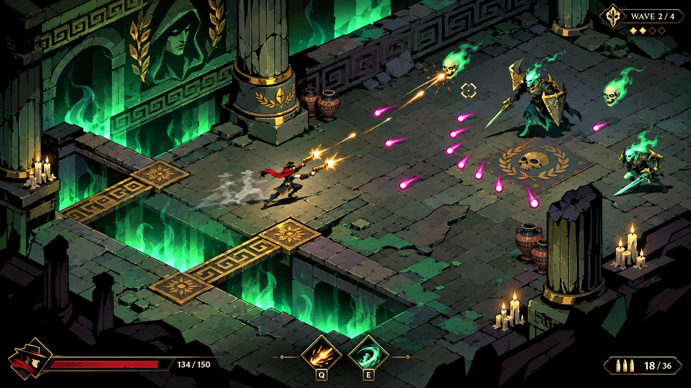

# CLAUDE.md — DREAD (working title)

Read this first. It explains what we are making, the look we are chasing, how the art is
produced, how the code is organised and how to test changes. Deeper docs:
[`docs/PLAN.md`](docs/PLAN.md) covers architecture decisions and status,
[`docs/ASSETS.md`](docs/ASSETS.md) covers the sprite/audio contract, and
[`README.md`](README.md) covers controls and dev flags.

## 1. What we're making

**Genre:** a **2D isometric action-RPG twin-stick shooter**: fast, aggressive, loot-driven
dungeon crawling. It is fully 2D in **Godot 4.7.x (GDScript)**. Characters only *look* 3D
because they are pre-rendered from Blender.

**Feel targets (the original brief):**
- **DreadHunter:** isometric gunplay, aggressive encounters, weapon feedback.
- **DOOM Eternal:** relentless aggression, resource loops, visceral destruction.
- **Diablo IV:** loot rarity, builds, synergies, dungeon crawl.
- **Warframe:** fluid movement and abilities.
- **The Ascent:** dense isometric presentation.

**Pillars:** Speed · Impact · Fluidity · Progression · Chaos *with readability*.

**It is NOT:** a cover shooter, a slow tactical shooter, wave survival, or an extraction
game. "Waves" exist only as encounter beats inside rooms. The player should feel like an
apex predator: dash through formations, flank armoured enemies, pop explosives in crowds,
execute staggered enemies for health. **The game must be fun before it becomes big.**
Judge every feature by: does it make combat more satisfying, responsive, readable, or create
interesting decisions / build diversity?

**Original directive guardrails (keep honouring them):**
- Movement is never locked by animations; shooting, dashing and abilities overlap freely.
- Every enemy attack is telegraphed (pose + ground marker + sound) and is interruptible
  by stagger.
- Encounters mix enemy roles; never just "more of the same enemy".
- Loot modifiers change *behaviour* (pierce, ricochet, split, chain, explode, sustain),
  not just numbers.
- Camera shake is budgeted, hit-stop is short and rare, and VFX must never hide the fight.
- The architecture is modular and data-driven (Resources, a signal bus) and avoids giant
  scripts.

## 2. Art direction: Hades-style visuals, DreadHunter gameplay

The owner wants the game to look like **Hades**, with gameplay closer to **DreadHunter**:
a **hand-inked, cel-shaded mythic Greek underworld**.

**Concept art by the owner (the target look):**

| Mockup | What to take from it |
|---|---|
|  `docs/concept/mockup_01_soul_fire_temple.webp` | Dark green-stone temple, gold Greek-key (meander) trim, laurel/skull floor emblems, broken columns, urns, candles, **bright green soul-fire pits**. Gunslinger (hat, red scarf, dual pistols) with dash afterimages and golden tracers. Enemies: shield/sword skeleton warriors with green flame, flaming skulls, magenta enemy projectiles. HUD: portrait in a gold diamond plus a long red health bar (bottom-left), Q/E diamond ability icons (bottom-centre), "WAVE 2/4" plate with diamond pips (top-right), ammo "18/36" with bullet icons (bottom-right). |
|  `docs/concept/mockup_02_forge_lava.webp` | **Second biome (not built yet):** forge/lava: molten channels, gears, chains, red banners, furnace altars, giant statue head. Enemies: floating sorceresses firing red diamond shard spreads, hellhounds, cloaked shield warriors. Same HUD language. |

**Gameplay/feel references (DreadHunter screenshots):** `docs/concept/ref_dreadhunter_01..05_*.webp`.
These show camera angle, scale, density, HUD placement and lightning/critical-hit VFX.
They are reference only and not shipped art.

**Style rules:**
- Thick dark ink silhouettes and inner lines.
- 3-band toon shading with purple-tinted shadows.
- Saturated but dark palette: green-black stone, gold accents, crimson cloth.
- Bright emissive accents: green soul-fire, warm torches, magenta enemy magic.
- Strong colour separation: player is warm red/gold, enemies get a red rim and elites a
  gold rim, danger telegraphs are always red, spawns are green.
- UI font is **Cinzel** (`assets/fonts/`, OFL licence included), with gold frames and
  diamonds.

**The owner plans to make their own final art eventually.** Treat everything in
`assets/sprites` as high-quality placeholder. Keep all art behind the sheet contract
(`docs/ASSETS.md`). Never hard-code sprite sizes or offsets in gameplay code.

## 3. Current state (what exists)

All of this is playable, and a bot plays the whole route without errors:

- **Player (gunslinger):**
  - Responsive movement and a 2-charge dash with i-frames.
  - Twin-stick aim: mouse soft-lock, or stick with aim assist.
  - Three weapon slots: Twin Hellfire Revolvers (alternating barrels), Hellmouth
    Blunderbuss, Stormcaller (heat-based chain lightning).
  - Longshot (charge rail) as loot.
  - RMB Firebomb.
- **Abilities:** Q Shock Nova, E Seeker Swarm, F **Fury's Lash** (bullwhip, `lash.gd`):
  - Tap: crack along the aim line (5 m reach). The last 1.5 m is a sweet spot that always
    crits. The rope snaps enemy shots out of the air.
  - Hold: the tip latches on. Light enemies are yanked to point-blank range and dazed.
    Heavies (mass ≥ 3) pull the player to them instead, and a frontal yank wrenches the
    Legionnaire's shield aside. Flaming Skulls can't be yanked (`EnemyData.yankable`).
  - Cracking a staggered (or nearly dead) enemy drags it in for a point-blank execute
    shot that bursts into health.
  - F during or just after a dash spins the whip in a full circle.
  - The rope is drawn live (`player/whip_visual.gd`, two Line2Ds), not a sprite sheet.
    The coiled whip on the left hip is part of the legs render.
- **Enemies** (internal ids stay `mite/spitter/brute/bloater`; names and art are themed):
  - **Hellhound** (`mite`): flanking swarmer, pounce.
  - **Hex Witch** (`spitter`): flying caster, shard fans.
  - **Shade Legionnaire** (`brute`): tower shield = 70% frontal armour (breakable), weak
    back, slam + charge, stuns itself on walls.
  - **Flaming Skull** (`bloater`): flying kamikaze that hurts enemies too.
  - **Elite affix layer:** frenzied, shielded, volatile, molten.
- **Loot:** six rarities, stat affixes, behaviour affixes and legendary/mythic perks.
  Also inventory (Tab), XP/levels and four attributes.
- **Dungeon:** one handcrafted level (`src/dungeon/layout_test.gd`, ASCII):
  - Threshold → Bone Corridor → secret Reliquary behind a breakable wall.
  - Locked Kennels arena (nests spawn hounds until destroyed).
  - Stormwalk (shock-plate hazard).
  - Hall of the Legion (elite finale) → descent portal to depth N+1, with harder enemies.
- **Presentation:**
  - Pooled VFX: particles, lights, decals, telegraphs.
  - Hit-stop, trauma shake, HDR glow, post FX.
  - Normal-mapped dynamic 2D lights.
  - Green soul-fire abyss shader.
  - Procedural SFX and layered music.
  - Gold-diamond HUD and minimap.
- **Performance:**
  - Low/Medium/High presets (F4, auto-picked by GPU, auto step-down below 45 FPS).
  - VRAM-compressed sprites (~122 MB).
  - Tiered static lights and a 1080p render cap on large screens.
  - F3 overlay.

**Not built yet / next ideas:**
- Forge/lava biome (mockup 02).
- Basic skeleton swordsman enemy.
- A boss with phases.
- Skill tree (reuse `Build.stat()` and perk hooks).
- Procedural room stitching.
- Options menu and save/load.
- Painted-art pass over the renders.
- Tuning by human playtest.

## 4. Code map

```
src/world.gd        Scene root: layers, environment, level build/rebuild, enemy factory, graphics presets, dev flags
src/autoload/       InputSetup (all bindings) · Events (signal bus) · Game (refs, hit-stop, settings) · Audio · VFX
src/core/           iso.gd (projection math) · sheet_db.gd (sprite sheets) · damage_info.gd
src/player/         player.gd (controller, weapons, inventory) · player_visual.gd (legs+torso compositor) · whip_visual.gd (live rope)
src/combat/         weapon_data/weapon/weapon_db · projectile(_system) · combat.gd (hit/explode) · build.gd (stats + perk hooks) · perks/
src/enemies/        enemy_data · enemy.gd (base FSM, armour, stagger, status, death) · mite/spitter/brute/bloater · elite.gd
src/abilities/      shock_nova · seeker_swarm · lash (F whip: crack / yank / execute / whirl)
src/loot/           item · loot (generation/drops) · pickup
src/dungeon/        layout_test (ASCII + rooms/beats) · dungeon.gd (grid collision, DDA raycast, flow field, floor/walls/lights) · encounter_director · prop · doors/portal/shock floor
src/ui/             hud.gd (procedural HUD + minimap) · inventory_ui.gd
src/vfx/            shaders/ (entity, glow_rim, post, post_lite, void_bg) · camera · post_fx · telegraph · tex_gen · glow_mat
src/debug/          bot_driver.gd (automated playtester)
data/weapons, data/enemies   .tres definitions — tune numbers here, not in code
```

**Key concepts:**
- **Three coordinate spaces** (`src/core/iso.gd`):
  - *screen* = node positions.
  - *ground* = `(x, y / 0.75)`, true metric with 1 m = 90.51 px. All speeds, radii and
    AoE use this.
  - *tile* = grid coords, where walls are axis-aligned squares.
- **Projection:** a 2 m cell is a 256×192 diamond. A metre of height is 59.87 screen px.
  `Iso.lift(g, h_m)` draws a point that is h metres above the ground.
- **Collision:** custom grid collision and DDA raycasts (not physics bodies) for actors
  and projectiles. Enemy AI uses a flow field toward the player plus soft separation.
- **Combat routing:** all player damage goes through `Combat.hit_enemy()`, so the
  `Build`/`Perk` hooks (`before_hit`, `after_hit`, `on_kill`, `on_fire`, `on_dash`,
  `on_explosion`) fire for every source. To add a modifier, write a Perk class in
  `perk_lib.gd` and give it an `INFO` entry.
- **Content is data-driven:**
  - New gun = a `.tres` file plus an optional torso sheet.
  - New enemy = a `.tres` file plus a behaviour subclass of `Enemy`, registered in
    `World.spawn_enemy()`.
  - Room encounters = `ROOMS` beats in the layout file.
- **Systems talk through `Events` signals.** The HUD, audio, encounters and bot listen
  there.

## 5. Art production method (Blender → 2D sprites)

All placeholder art is built procedurally in **Blender via the `bpy` Python module**:
models are made from primitives in code, then rendered through a custom stylizer.

- **Setup:** `python3 -m venv ~/venvs/bpy && ~/venvs/bpy/bin/pip install bpy==5.3.0 pillow numpy`
  (needs Python 3.13). Always `import common` before `from mathutils import ...`,
  because bpy provides mathutils.
- **Rig** (`tools/blender/common.py`): orthographic camera, yaw 45°, pitch asin(0.75) ≈
  48.6°, 90.51 px/m, so it matches `Iso` exactly. Key light from screen upper-left, cool
  rim from behind.
- **Stylizer** (`render_stylized()`): every frame is rendered at 2× supersampling as
  separate Cycles passes:
  - flat **albedo** (emission branch inside every material)
  - **lighting** (white diffuse override, including self-shadowing)
  - **meta** (metalness, emissive flag, view depth)
  - **normal** (top-down frame for Godot `Light2D`)
  - **emission**

  numpy then composites them:
  - 3 light bands with purple shadow tint
  - gold/metal glints
  - paper grain
  - ink lines from depth/normal/albedo discontinuities plus a dilated outer silhouette

  The result is downsampled to final size. Tune it with `common.STYLE`.
  `build_env.py` uses calmer `ENV_STYLE`/`FLOOR_STYLE` so floors stay readable under
  combat.
- **Painted textures** (`tools/blender/textures/`): environment surfaces can use painted
  images instead of flat colours. They are made with the environment prompt book
  (https://claude.ai/artifact/9JXvw5rE37iezcSMhqP5Yv) and must be flat and straight-on,
  never isometric.
  - `C.mat(..., tex=C.tex_path("file.png"), tex_size=(x, y, z))` maps one onto a model
    (metres per repeat along object X/Y/Z, centred on the object's origin). The image
    feeds the albedo pass too, so shading, ink lines and normal maps still come from the
    stylizer. Options: `tex_proj` (`"FLAT"` for floors, because Cycles' box projection
    swaps axes on upward faces; `"BOX"` for walls), `tex_rot`, `tex_extension`
    (`"EXTEND"` for single non-tiling images), `tex_gain`, and `tex_emit` for painted
    light such as flames.
  - `build_env.py → PAINTED` says which file each floor/wall kind uses. A missing file
    falls back to the modelled look, so the kit still runs without textures.
  - Current set: `floor_flag`, `floor_cracked`, `floor_moss` (lifted ×1.3 in the
    material), `floor_border_meander`, `floor_emblem_skull`, `wall_ashlar` (made from
    `wall_ashlar_v1` with the gold band moved lower; replace it with a regenerated one),
    `soulfire_flames` (fire-alcove niches). `column_wrap_v1` is unused: painted flutes
    don't read at game size, so the column keeps its modelled flutes.
- **Output** goes to `assets/sprites/<category>/<name>_c.png` (colour), `_n.png`
  (normal), `_e.png` (emission) and `.json` (frame size, origin = feet/tile centre,
  rows = directions). See `docs/ASSETS.md`.
- **Directions:** row 0 faces screen-right and rows go clockwise; row 4 of 16 faces the
  camera. Characters use 16 dirs. The player torso uses 32 aim dirs in a 4×8 grid; the
  legs sheet uses 16 dirs with 8 run frames + 1 idle.
- **Scripts and render times (4 cores):**
  - `build_player.py`: gunslinger legs, 4 torsos, HUD portrait (`-- portrait`); ~10 min.
  - `build_enemies.py`: hound/witch/legion/skull, one sheet per animation; ~20 min per
    pair. Run two processes in parallel.
  - `build_env.py`: 11 floor kinds, 7 wall kinds, 3 low blocks, 8 props; ~1.5 min.
    Index order is fixed because the layout legend maps to it.
- **Before full renders:** preview a few frames first (render a contact sheet with
  `render_stylized()` and look at it). That's how every model so far was iterated.
- **After re-rendering:** run `godot --headless --path . --import`. Sprites import
  VRAM-compressed (`compress/mode=2`, set as the project importer default).

## 6. Testing & tooling

```bash
godot --headless --path . --import                                    # refresh imports + class_name cache (needed after adding class_name scripts)
godot --headless --path . res://tools/dev/check_scripts.tscn          # compile-check every script/resource
godot --headless --path . --fixed-fps 60 -- --bot --quit-after=120    # automated playthrough, prints a combat log
godot --headless --path . --fixed-fps 60 -- --bot --bot-human --bot-nododge --quit-after=120   # harder difficulty probe
godot --path . -- --start=reactor --depth=2 --gfx=low                 # jump to a room / depth / preset while playing
```

- **Rooms for `--start`:** `landing conduit vault hatchery spine reactor`.
- **Other dev flags:** `--shots=DIR --shot-every=S` (screenshots), `--inv-shot`
  (inventory test), `--dmg-mult=N` (forced deaths), `--bench=S` (avg FPS),
  `--g-<setting>=v` (per-setting overrides).
- **Headless cloud containers:** run rendered screenshots with
  `VK_ICD_FILENAMES=/opt/lavapipe/lvp_icd.json xvfb-run -a -s "-screen 0 1920x1080x24" godot --path . --resolution 1920x1080 --fixed-fps 30 --audio-driver Dummy -- --bot --start=hatchery --shots=/tmp/s --shot-every=2 --quit-after=8`.
  The software renderer gives about 2–5 FPS, so numbers are only relative. **Always look
  at screenshots after visual changes;** many readability bugs were only visible there.
- **Normal-map sanity check:** `tools/dev/light_test.gd`.

## 7. Gotchas & conventions

- **GDScript type inference:** `:=` fails when the value comes through an untyped
  reference (e.g. `var x := some_untyped.method()`). Use explicit types
  (`var x: float = ...`). `Game.*` refs are typed so they're safe.
- **Class cache:** new `class_name` scripts aren't visible until
  `godot --headless --import` refreshes the cache.
- **Exports:** sprite JSON is read via `FileAccess`. Exports must include `*.json` as a
  non-resource filter.
- **`docs/` is ignored by Godot** via `.gdignore`. Keep concept art and screenshots there.
- **Godot rewrites `project.godot`** when the editor opens it. Pulls can then fail with
  "local changes". The fix is `git stash`, then `git pull`, then `git stash drop`.
- **Don't break the light model:**
  - Sprites are pre-shaded, so `CanvasModulate` ambient stays near-neutral (0.9–1.0).
  - Lights add highlights only.
  - Explosion and ring VFX must stay modest. HDR bloom turns big additive sprites into
    screen-filling blobs.
- **Readability rules learned the hard way:**
  - Decorative floor art must never look like telegraphs (red rings) or pickups
    (glowing dots).
  - Spawns are green; attack warnings are red.
  - Keep floors calm.
- **Performance rules:**
  - No per-frame heavy GDScript drawing; use throttled canvas items like the minimap.
  - Don't push shader params every frame unless they changed.
  - New static lights need a tier (0 key / 1 accent / 2 fill).
  - New screen-reading shaders cost a full-frame copy.
- **Git:**
  - Commit `.import` files for assets.
  - Never commit `.godot/`.
  - Generated art and audio are committed so the project runs without Blender.

## 8. Owner preferences

- **Style:** wants **Hades-style visuals with DreadHunter-like gameplay**, and is happy
  with the current direction ("looks pretty dope so far").
- **Art ownership:** will eventually supply their own art for environment, enemies and
  character, so keep the pipeline swappable.
- **Hardware:** reported lag on their machine once, which is why the performance presets
  and auto-quality exist. Keep perf in mind and ask for their F3 overlay numbers if
  "laggy" comes up.
