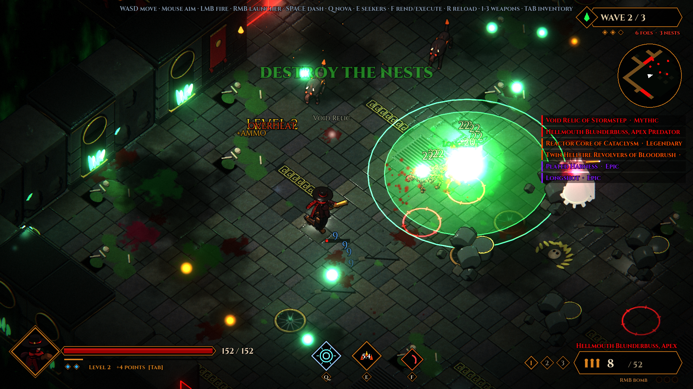

# DREAD

An isometric action-RPG twin-stick shooter (vertical slice) built in **Godot 4.7** with GDScript —
a gunslinger fighting through a mythic underworld, in a hand-inked, cel-shaded style.
It plays fast and aggressive, with movement, gunplay, abilities and loot pulling against each other:
dash through formations, flank armoured brutes, pop bloaters inside crowds, execute staggered
enemies for health, and build around behaviour-changing legendaries.

> The art is placeholder: procedural 3D models in Blender, rendered through an ink + cel-shading
> stylizer into 2D sprites (with normal and emission maps for dynamic 2D lighting). The game itself is
> fully 2D. See [`docs/ASSETS.md`](docs/ASSETS.md) to drop in your own art.



## Run it

1. Open the folder in **Godot 4.7.x**. Godot imports the assets on first open.
2. Press **F5**. The main scene is `scenes/main.tscn`.

## Controls

| Action | Keyboard / mouse | Gamepad |
|---|---|---|
| Move | WASD | Left stick |
| Aim | Mouse (soft-locks onto enemies under the cursor) | Right stick (aim assist) |
| Fire weapon | LMB | RT |
| Hellfire Saber: tap / hold for the combo, right after a dash for a dash-slash | RMB / V | B / RB |
| Dash (i-frames, 2 charges) | Space / Shift | A / LB |
| Shock Nova | Q | X |
| Seeker Swarm | E | Y |
| Firebomb | F / G | LT |
| Reload | R | R3 |
| Switch weapon | 1 2 3 / mouse wheel | D-pad |
| Inventory, attributes | Tab / I | Back |
| Pause | Esc | Start |
| Debug / performance overlay | F3 | — |
| Cycle graphics preset (Low / Medium / High) | F4 | — |

## What's in the slice

### Weapons
Each weapon is a data-driven `WeaponData` resource in `data/weapons/`.

| Weapon | Behaviour |
|---|---|
| **Twin Hellfire Revolvers** | Alternating barrels, golden tracers; accuracy blooms under sustained fire. |
| **Hellmouth Blunderbuss** | 10 pellets, loads shell by shell, huge knockback, falls off hard at range. |
| **Stormcaller** | Lightning that chains between targets. Runs on heat, never ammo. |
| **Longshot** | Charged rune bolt that pierces everything in a line. Loot drop. |
| **Firebomb** (RMB) | Lobbed bombs on recharging charges. |

### Enemies
Every attack is telegraphed on the ground before it lands.

| Enemy | Role |
|---|---|
| **Hellhound** | Flanking swarmer. Crouches, then pounces in a straight line you can dodge. |
| **Hex Witch** | Floating caster. Keeps her distance and fans out leading volleys of crystal shards. |
| **Shade Legionnaire** | Tower shield = frontal armour (70%, breakable); weak back (+60%), slow turning. Overhead sword slam on a marked circle, shield charge in a line, stuns itself on walls. |
| **Flaming Skull** | Flies over obstacles and detonates on players **and** enemies. Shoot it while it's next to its friends. |

- **Elites** can roll any of four affixes: **Frenzied**, **Shielded** (shield regenerates; breaking it staggers), **Volatile** (mines) and **Molten** (fire trail).

### Abilities
- **Shock Nova:** knocks enemies back, applies shock, and erases enemy projectiles.
- **Seeker Swarm:** homing missiles.
- **Hellfire Saber** (RMB):
  - **Combo:** slash, back-slash, heavy cleave. Every swing lunges you forward and snaps
    onto an enemy in front, so pressing on enemies closes the gap.
  - **Dash-slash:** RMB during or right after a dash pierces through a whole line.
  - **Execute:** any swing on a staggered or nearly dead enemy finishes it in a burst of
    health and ammo. Every sword kill spills ammo and health.
  - **Deflect:** the slash cuts enemy shots out of the air.

### Loot and progression
- **Rarities:** six, from Common to Mythic.
- **Stat affixes:** standard rolled bonuses.
- **Behaviour affixes:** pierce, ricochet, chain, split, crit-explode, ammo-on-kill, momentum.
- **Legendary perks:** for example, *every 5th shot explodes*, *dash leaves a lightning trail*, *critical kills chain lightning*, *kill streaks stack damage*.
- **XP and levels:** with four attributes to spend points in.

### Dungeon
The game opens in **the temple dungeon** (`src/dungeon/layout_temple.gd`), five rooms
painted in the style of the concept art, joined by gold bridges over the abyss:

1. The Soul-Fire Temple: soul-fire pits crossed by gold bridges.
2. The Hooded Sanctum: a nave split by a soul-fire moat.
3. The Bone Altar: bone nests spawn hounds until you break them.
4. The Great Stair and the Undercroft: a gallery, a grand stair down, and a sunken hall
   where witches shoot down from above.
5. The Hall of Shades: a big shrine hall with three waves.
6. The Isles of Lethe: a lake of soul-fire crossed by isles and bridges, where geysers
   erupt over the bridges in turn (watch for the red ring) and burn enemies too.
7. The Weaver's Deep: the boss arena. Arachne, the Titan Weaver, a colossal spider with
   an armoured masked front and a glowing amber heart at its rear: circle it, bait its charge
   into a column, dash through its rings of fire. Killing it opens the descent portal to
   the next depth, where enemies are stronger.

The original test level is still there with `--level=test`:

1. Landing bay.
2. Conduit.
3. Hidden vault, behind a breakable wall.
4. Locked Hatchery arena, where nests spawn mites until you destroy them.
5. Shock-plate corridor.
6. Reactor arena with an elite finale.
7. Descent portal to the next depth, where enemies are stronger.

### Feel
- Hit-stop on impact.
- Trauma-based camera shake and recoil kicks.
- Dynamic normal-mapped lights from muzzle flashes and explosions.
- HDR bloom.
- Dissolve deaths and gore decals.
- Damage numbers.
- Post-processing: chromatic aberration kicks, low-health pulse.
- Two-layer music that rises with combat intensity.

## Project layout

```
src/autoload/   InputSetup, Events (signal bus), Game, Audio, VFX
src/core/       Iso projection math, sprite-sheet loader, DamageInfo
src/player/     Player controller + legs/torso compositor
src/combat/     WeaponData/Weapon, ProjectileSystem, Combat, Build (stats+perk hooks), perks, hazards
src/enemies/    EnemyData, Enemy base FSM, archetypes, elite affixes
src/abilities/  Shock Nova, Seeker Swarm, Hellfire Saber
src/loot/       Item, Loot generation, pickups
src/dungeon/    Layout (ASCII), Dungeon (grid collision/raycasts/flow field/visuals), encounters, doors, hazards
src/ui/         HUD, inventory
src/vfx/        Shaders, camera, post-fx, telegraphs, procedural textures
src/debug/      BotDriver (automated playtester)
data/           Weapon and enemy .tres definitions (tune here)
tools/blender/  Asset pipeline (bpy)
tools/audio/    SFX/music synthesis
docs/           PLAN.md (architecture & decisions), ASSETS.md (art contract)
```

## Developer tools

```bash
# compile-check every script
godot --headless --path . res://tools/dev/check_scripts.tscn

# headless automated playthrough (prints a combat log)
godot --headless --path . --fixed-fps 60 -- --bot --quit-after=120

# harder probe: sloppy human-like aim, no dodging
godot --headless --path . --fixed-fps 60 -- --bot --bot-human --bot-nododge --quit-after=120

# rendered run with screenshots every 3 s of game time, starting in an arena
godot --path . --fixed-fps 30 -- --bot --start=altar --shots=/tmp/shots --shot-every=3 --quit-after=20

# jump straight to a room / depth while playing
godot --path . -- --start=gallery --depth=2

# start with the three void guns in your slots (any weapon ids from data/weapons)
godot --path . -- --weapons=repeater,lance,scatter

# the original test level
godot --path . -- --level=test --start=reactor
```

Rooms you can pass to `--start`: `temple`, `sanctum`, `altar`, `gallery`, `undercroft`,
`shades`, `lethe`, `arena` (temple dungeon); with `--level=test`: `landing`, `conduit`, `vault`, `hatchery`,
`spine`, `reactor`.

## Performance & graphics presets

F4 cycles **Low / Medium / High** (saved to `user://settings.cfg`). On first launch the game picks
Low for integrated GPUs and Medium otherwise, and steps down automatically (up to twice) if the frame
rate stays under ~45 FPS. F3 shows FPS, frame/script time, draw calls, video memory and the GPU name.

| | Low | Medium | High |
|---|---|---|---|
| Bloom | off | wide levels only | full |
| HDR 2D | off | on | on |
| Background fog | flat colour | 2 texture layers | 3 layers + shafts + motes |
| Static lights | key lights | + accents | + overhead fill pools |
| Post-process | overlay only (no screen copy) | full | full |
| Render cap on >1080p screens | 1080p | 1080p | native |
| Particles | 50% | 80% | 100% |

Sprites import as VRAM-compressed (DXT/BC) textures: ~122 MB of video memory instead of ~544 MB.

## Exporting

Sprite-sheet metadata (`assets/sprites/**/*.json`) is read at runtime with `FileAccess`. In the
export preset, add `*.json` under **Resources → Filters to export non-resource files**.
